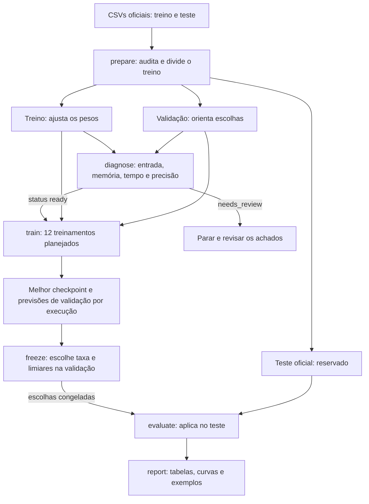
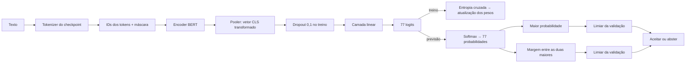

# Arquitetura do experimento

Este documento mostra **o código atual** e os dados que passam entre suas partes. Os nomes de arquivos gerados são exemplos de artefatos; eles ainda não comprovam que uma execução aconteceu.

**Estado:** o fluxo foi escrito, mas ainda não foi validado de ponta a ponta com PyTorch, os checkpoints e o BANKING77 reais. A documentação descreve a implementação atual, não garante que ela esteja livre de falhas. As decisões científicas e seus limites estão em [PLAN.md](PLAN.md); a sequência de trabalho está em [IMPLEMENTATION.md](IMPLEMENTATION.md).

## Visão geral

Cada mensagem é um texto associado a uma intenção, como uma pergunta sobre um cartão. Ela passa por três momentos diferentes:

1. **Treinamento:** exemplos de treino ajustam os pesos do modelo.
2. **Seleção:** exemplos de validação escolhem a melhor época, a taxa e os limiares de abstenção.
3. **Avaliação final:** o teste oficial mede as escolhas já congeladas; seus resultados não ajustam o modelo nem os limiares.



O orçamento planejado é **2 modelos × 2 taxas × 3 seeds = 12 treinamentos**, cada um com cinco épocas. Após selecionar a taxa de cada modelo, permanecem **três seeds por modelo** para o teste. Uma tentativa interrompida não conta como repetição completa.

## O caminho de uma mensagem



Os limiares são regras aplicadas **depois** do treinamento: não ajustam os pesos. Cada checkpoint usa seu próprio tokenizer. O padding é dinâmico e à direita; se uma mensagem exceder o limite escolhido, o código interrompe em vez de cortar o texto.

## Contratos dos comandos

Os comandos são chamados com `python -m nlp_finance <comando>`. Detalhes de execução estão no [README.md](README.md). `Path` abaixo significa caminho de arquivo ou pasta.

| Comando | Entradas | Saídas | Condição para prosseguir |
|---|---|---|---|
| `prepare` | CSVs `--train` e `--test`, revisão `--revision`, pasta nova `--output` | `manifest.json`, `splits.json`, `audit.json` | Contagens esperadas, 77 rótulos e revisão dos achados relevantes. |
| `diagnose` | Pasta preparada, JSON de revisões dos dois checkpoints, pasta nova, dispositivo CUDA | `diagnostic.json`, com medições e status | `ready` libera o fluxo de treino atual; `needs_review` exige analisar os achados. |
| `train` | Pasta preparada, diagnóstico, JSON de configuração, pasta nova da tentativa | Checkpoint, logs e previsões de validação | Diagnóstico compatível; cinco épocas concluídas; verificações de releitura e baseline. |
| `freeze` | Pasta preparada, **12 pastas** de tentativas completas, caminho de saída novo | JSON do protocolo congelado | Todas as combinações de modelo, taxa e seed precisam estar presentes e consistentes. |
| `evaluate` | Pasta preparada, JSON congelado, pasta nova, dispositivo | Previsões e métricas de teste para seis execuções, baseline e resumo | Confere hashes, limites de entrada e reprodução da validação antes de gerar previsões do teste. |
| `report` | Pasta preparada, JSON congelado, pasta da avaliação, pasta nova | CSVs, JSONs e figuras SVG | Avaliação deve corresponder ao protocolo congelado. |

O fluxo usa arquivos locais para tokenizers e checkpoints. Downloads de pesos e instalação de dependências **não são feitos por esses comandos**.

### Configurações de entrada

O JSON de revisões tem exatamente os dois nomes de modelo como chaves e um hash completo de commit como valor. Exemplo de formato, com valores **ilustrativos, não revisões reais**:

```json
{
  "google-bert/bert-base-uncased": "aaaaaaaaaaaaaaaaaaaaaaaaaaaaaaaaaaaaaaaa",
  "yiyanghkust/finbert-pretrain": "bbbbbbbbbbbbbbbbbbbbbbbbbbbbbbbbbbbbbbbb"
}
```

O JSON de **uma tentativa** contém os campos abaixo. Os valores de `batch_size`, `max_length` e `precision` devem ser os escolhidos no diagnóstico. Esta é apenas uma configuração ilustrativa:

```json
{
  "model_name": "google-bert/bert-base-uncased",
  "revision": "aaaaaaaaaaaaaaaaaaaaaaaaaaaaaaaaaaaaaaaa",
  "seed": 13,
  "learning_rate": 0.00002,
  "precision": "amp_fp16",
  "batch_size": 16,
  "max_length": 64,
  "device": "cuda"
}
```

As seeds previstas são `13`, `37` e `73`; as taxas de pico são `0.00002` e `0.00005`. O diagnóstico decide o batch comum entre `8`, `16` e `32` e o limite de `64` ou `128` tokens conforme os dados de desenvolvimento. A implementação atual só marca o diagnóstico como `ready` quando a candidata AMP passa seus critérios; se isso não ocorrer, registra `needs_review`, sem escolher FP32 automaticamente.

## Contratos dos dados e artefatos

### Exemplo em memória

O CSV de origem deve conter as colunas `text` e `category`. Após a leitura, cada linha é representada por:

```text
{ "id": "official_train:0", "text": "...", "label": "..." }
```

`id` combina a divisão oficial com a posição original. Depois da reconstrução, o exemplo também recebe `label_id`, inteiro de `0` a `76`, conforme o mapeamento salvo. A seed da divisão é `42`; a lista de IDs também é salva, pois seed sozinha não identifica os arquivos de origem. A divisão usa `train_test_split` do scikit-learn, como no laboratório; ela pode escolher IDs diferentes da implementação anterior, mesmo com a mesma seed.

### Preparação

| Artefato | Conteúdo de saída | Usado por |
|---|---|---|
| `manifest.json` | Revisão informada, caminhos e SHA-256 dos CSVs, hash da divisão, seeds, `label_to_id` e baseline majoritário na validação. | Reconstrução dos dados, diagnóstico, treino e congelamento. |
| `splits.json` | Listas de IDs para `train`, `validation` e `test`. | Reconstrução das mesmas divisões. |
| `audit.json` | Contagens, IDs vazios e grupos de duplicatas exatas ou comparadas após normalização de espaços, com indicadores de sobreposição e conflito de rótulo. | Revisão de problemas antes do diagnóstico e treino. |
| `audit_review.json` | Quando exigido por achados relevantes: `audit_sha256` e `author_decision`. | Confirma que a decisão registrada se refere à auditoria atual. |

SHA-256 é uma impressão digital do conteúdo: ajuda a perceber que um arquivo ou divisão mudou. O código registra a revisão fornecida; conferir se ela corresponde à origem continua sendo necessário.

### Diagnóstico e tentativa

`diagnostic.json` contém `status`, hash da preparação, revisões, informações do ambiente, hashes de código/checkpoints e estatísticas de comprimento. Quando as medições prosseguem, inclui IDs da amostra, benchmarks, estabilidade e estimativas de tempo. Ao terminar com `ready`, inclui também `batch_size`, `max_length` e `precision` usados pelo comando `train`.

A amostra do diagnóstico usa `train_test_split` estratificado. Seus 512 IDs podem diferir da implementação manual anterior, mesmo com a mesma seed; eles são registrados no relatório. Essa mudança pode afetar a medição de recursos e ainda precisa ser verificada com as bibliotecas reais.

Cada pasta de tentativa pode conter:

| Arquivo | Conteúdo |
|---|---|
| `config.json` | Configuração da execução e hashes da preparação e do diagnóstico. |
| `loading_info.json` | Informações do carregamento dos pesos do encoder. |
| `optimizer_groups.json` | Nomes dos parâmetros com e sem weight decay. |
| `updates.jsonl` | Um registro por atualização: tentativa, perda, salto AMP, escala e taxa. |
| `epochs.json` | Acurácia, Macro-F1, acertos e total por época de validação. |
| `best_model.pt` | Pesos da época selecionada pela validação. |
| `trainer_checkpoints/` | Checkpoints salvos pelo Trainer durante a tentativa. |
| `validation_logits.pt` | Logits da validação antes de recarregar o checkpoint, para comparação. |
| `validation_predictions.npz` | Previsões da validação geradas após recarregar os pesos. |
| `result.json` | Status `completed`, `failed` ou `needs_review` e resumo disponível. |

Uma falha pode deixar apenas parte dos arquivos. Reiniciar usa **outra pasta**, mesma configuração e seed; o código não retoma um checkpoint parcial. Se uma correção alterar resultados, todas as execuções afetadas precisam ser identificadas e refeitas conforme o plano.

### Previsões e congelamento

Um arquivo `.npz` de previsões contém arrays sem objetos:

| Campo | Formato | Significado |
|---|---|---|
| `ids` | `N` strings | Identificadores dos exemplos, em ordem. |
| `labels` | `N` inteiros | Rótulos verdadeiros de `0` a `76`. |
| `logits` | `N × 77`, FP32 | Saídas da camada linear antes do softmax. |
| `probabilities` | `N × 77`, FP64 | Probabilidades obtidas a partir dos logits com `torch.softmax`. |

O arquivo congelado guarda hashes da preparação, as taxas selecionadas, três checkpoints por modelo, hashes das previsões de validação e limiares por **modelo × seed × regra × meta**. As metas são `95%`, `90%` e `80%`; a referência sem abstenção tem cobertura de `100%`.

Na avaliação, cada regra aceita scores **maiores ou iguais** ao limiar. Empates no limite são aceitos juntos. A cobertura observada no teste pode diferir da meta estabelecida na validação; o limiar não é reajustado.

### Avaliação e relatório

`evaluate` gera, para cada uma das seis execuções selecionadas, um `.npz` de teste e um JSON com acurácia, Macro-F1, métricas por intenção, ECE, AURC, curvas e pontos operacionais. Também gera `baseline.json` e `summary.json`.

`report` produz `classification.csv`, `abstention.csv`, `aggregate.json`, `confusions.json`, `examples.json`, curvas risco–cobertura e diagramas de confiança em SVG. As três seeds descrevem variação das execuções naquele split; não são, por si só, teste de significância.

## Contratos das funções por arquivo

As tabelas abaixo descrevem as funções disponíveis no código; não implicam que todas tenham sido executadas ou validadas com as dependências reais.

### Entrada e preparação

| Arquivo e função | Entrada → saída / efeito |
|---|---|
| [data.py](src/nlp_finance/data.py) `sha256` | Caminho → string com hash do arquivo. |
| `read_examples` | Caminho CSV e nome da divisão oficial → lista de exemplos com `id`, `text` e `label`. |
| `stratified_split` | Exemplos do treino oficial e seed → duas listas: treino e validação, com `train_test_split` estratificado. |
| `audit` | Dicionário de divisões → contagens e achados de vazios, duplicatas e conflitos. |
| `prepare_banking77_data` | Caminhos dos CSVs, pasta nova e revisão → resumo; salva manifesto, IDs e auditoria. |
| [dataset.py](src/nlp_finance/dataset.py) `load_prepared_data` | Pasta preparada → exemplos por divisão e manifesto, após conferir hashes e IDs. |
| `check_audit_review` | Pasta preparada → nenhuma saída; interrompe se um achado relevante não tiver decisão registrada. |
| `make_dataloader` | Exemplos, tokenizer, limite, batch e opção de embaralhar → lotes de tensores com `labels`. |
| [tokenization.py](src/nlp_finance/tokenization.py) `load_tokenizer` | Nome e revisão → tokenizer carregado do cache local, com padding à direita. |
| `token_lengths` | Tokenizer e textos → lista de comprimentos, com marcadores especiais e sem corte. |
| `tokenize_batch` | Tokenizer, textos e limite → tensores preenchidos; erro se houver excedentes. |

### Modelo e diagnóstico

| Arquivo e função | Entrada → saída / efeito |
|---|---|
| [model.py](src/nlp_finance/model.py) `load_model` | Nome e revisão locais → `BertForSequenceClassification` com 77 saídas e dropout 0,1; informa falhas de carregamento. |
| Modelo retornado | `input_ids`, `attention_mask` e, opcionalmente, `token_type_ids` → objeto cujo campo `logits` tem formato `batch × 77`. |
| [hardware_diagnostic/measurements.py](src/nlp_finance/hardware_diagnostic/measurements.py) `inspect_lengths` | Desenvolvimento e dois tokenizers → contagens de excedentes e limite escolhido, ou `None`. |
| `hardware_info` | Sem argumentos → informações do ambiente e GPUs disponíveis. |
| `diagnostic_sample` | Exemplos de treino e seed → amostra estratificada de 512 exemplos. |
| `benchmark_candidate` | Modelo, lotes, horizonte, dispositivo e precisão → tempo, throughput, memória e saltos. |
| `measure_amp_stability` | Modelo e lotes de treino → eventos e resumo das 20 tentativas iniciais e 100 medidas. |
| `stress_memory` | Modelo e lote de mensagens longas → memória após uma atualização. |
| `choose_batch` | Medições dos candidatos para os dois modelos → batch comum viável; erro se nenhum servir. |
| [checkpoints.py](src/nlp_finance/checkpoints.py) `checkpoint_files` | Modelo e revisão → hashes dos arquivos relevantes no cache. |
| [hardware_diagnostic/run.py](src/nlp_finance/hardware_diagnostic/run.py) `seed_diagnostic` | Sem argumentos → configura as seeds e opções determinísticas do diagnóstico. |
| `run_diagnostic` | Preparação, revisões, pasta e dispositivo → relatório e `diagnostic.json`. |

### Treinamento e seleção

| Arquivo e função | Entrada → saída / efeito |
|---|---|
| [training.py](src/nlp_finance/training.py) `create_optimizer` | Modelo e taxa → AdamW e nomes dos grupos com/sem decay usados no diagnóstico. |
| `create_scheduler` | Otimizador e atualizações planejadas → scheduler linear do Transformers e número de passos de warmup usados no diagnóstico. |
| `AmpMonitor` | Recebe indicadores de passos pulados via `record` → `summary` informa tentativas, saltos e janela; interrompe ao exceder D44. |
| `train_batch` | Modelo, lote, otimizador, scheduler, scaler, dispositivo e precisão → perda, salto, escala e taxa; usado no diagnóstico. |
| `evaluate_validation` | Modelo, lotes de validação e dispositivo → acertos, total, acurácia e Macro-F1. |
| `validation_logits` | Modelo, lotes de validação e dispositivo → tensor de logits para conferir a releitura. |
| `run_training` | Fábricas de modelo/lotes, configuração e pasta nova → encaminha a execução ao Trainer. |
| [trainer_training.py](src/nlp_finance/trainer_training.py) `run_with_trainer` | Fábricas, configuração e pasta nova → treina pelo Trainer e registra checkpoint, histórico e resumo. |
| `FP32ValidationTrainer` / `fp32_forward` | Adaptam a avaliação para FP32, inclusive quando o treino usa AMP; dependem da integração com Accelerate e ainda exigem validação real. |
| `StabilityCallback` | Observa atualizações do Trainer, registra saltos e aplica a regra de estabilidade AMP. |
| `compute_metrics` / `check_model_output` | Previsões → métricas de validação; saída do modelo → erro se logits ou perda não forem finitos. |
| [experiment.py](src/nlp_finance/experiment.py) `train_one` | Preparação, diagnóstico, configuração e pasta → executa a tentativa, confere o checkpoint e salva previsões de validação. |
| [model_selection.py](src/nlp_finance/model_selection.py) `select_epoch` | Métricas por época → maior acurácia; em empate, época mais antiga. |
| `select_rate` | Duas taxas, cada uma com três resultados → taxa selecionada pela média da validação; usa desempates definidos no plano. |

### Previsões, abstenção e entrega

| Arquivo e função | Entrada → saída / efeito |
|---|---|
| [predictions.py](src/nlp_finance/predictions.py) `predict` | Modelo, exemplos, tokenizer, limite, batch e dispositivo → IDs, rótulos, logits FP32 e probabilidades FP64. |
| `save_predictions` / `load_predictions` | Dicionário ↔ arquivo NPZ; a leitura confere formatos e valores. |
| [abstention_metrics.py](src/nlp_finance/abstention_metrics.py) `_validate` | Scores e acertos → nenhum retorno; rejeita tamanhos incompatíveis ou scores não finitos. |
| `threshold_for_coverage` | Scores de validação e meta → limiar que aceita pelo menos a cobertura desejada. |
| `selective_result` | Scores, acertos e limiar → cobertura, quantidade aceita e erro seletivo; erro é `None` se nada for aceito. |
| `aurc` | Scores e acertos → área risco–cobertura discreta, com tratamento dos empates. |
| `ece` | Confianças e acertos → ECE e dados das faixas de confiança. |
| [evaluation.py](src/nlp_finance/evaluation.py) `prediction_scores` | Previsões → classe prevista, acertos, MSP e margem. |
| `select_thresholds` | Previsões de validação → limiares por regra e meta, com cobertura e empates observados. |
| `classification_metrics` | Rótulos e classes previstas → acurácia, Macro-F1 e métricas por classe. |
| `risk_coverage_curve` | Scores e acertos → pontos de cobertura e erro ao final de cada bloco empatado. |
| `evaluate_predictions` | Previsões e limiares já selecionados → métricas de classificação, calibração e abstenção. |
| [freeze.py](src/nlp_finance/freeze.py) `read_completed_run` | Pasta de tentativa, exemplos de validação e hash da preparação → dados conferidos da execução e seus limiares. |
| `freeze_protocol` | Preparação, 12 pastas e caminho de saída → protocolo congelado, com taxa e três seeds por modelo. |
| [final_evaluation.py](src/nlp_finance/final_evaluation.py) `evaluate_frozen` | Preparação, protocolo congelado, pasta e dispositivo → previsões e métricas finais no teste. |
| [report.py](src/nlp_finance/report.py) `write_table` / `summarize` | Linhas e colunas → CSV; valores → média e desvio-padrão amostral. |
| `confusion_pairs` / `qualitative_examples` | Previsões e exemplos → pares mais confundidos e casos selecionados para análise. |
| `create_report` | Preparação, protocolo e avaliação → tabelas, JSONs e figuras em pasta nova. |
| [__main__.py](src/nlp_finance/__main__.py) `main` | Argumentos do terminal → chama um dos comandos acima. |

## Limites antes de executar

- A preparação e algumas fórmulas foram conferidas com exemplos sintéticos; o treinamento, o diagnóstico e a avaliação reais ainda exigem revisão e validação no ambiente com as dependências.
- Os checkpoints diferem em vocabulário e histórico de pré-treinamento. Resultados comparam os sistemas completos; não isolam causalmente o efeito do domínio financeiro.
- A mesma validação escolhe modelos e limiares. Isso pode adaptar demais as escolhas a essa amostra; o teste final avalia o procedimento congelado, sem garantir um limite de risco.
- O critério numérico de estabilidade do AMP é uma convenção prática do projeto, não uma garantia estabelecida pela literatura.
